<div align="center">

# Forge

**Describe it. Approve it. Ship it.**<br/>
Text → game-ready, rigged and animated 3D assets, on your own GPU.

[](LICENSE)


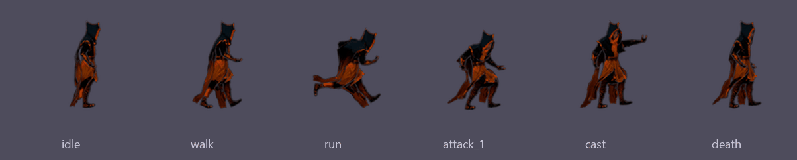

<sub>One sentence in, a rigged, animated character out — <i>"a young fire mage in scorched black and ember-orange silk robes"</i>.</sub>

</div>

---

Forge turns a text description into a **game-ready asset** — picture, textured mesh with LODs,
skeleton, animation clips, sprite sheets — and drops it straight into your **Unity** or **Godot**
project. Everything runs **locally on one NVIDIA GPU**; no cloud service, no per-asset fees, and
nothing leaves your machine.

You stay in charge: Forge stops at **three gates** for you to approve or reject, checks each step
with a local vision model, and can run whole batches on **autopilot**.

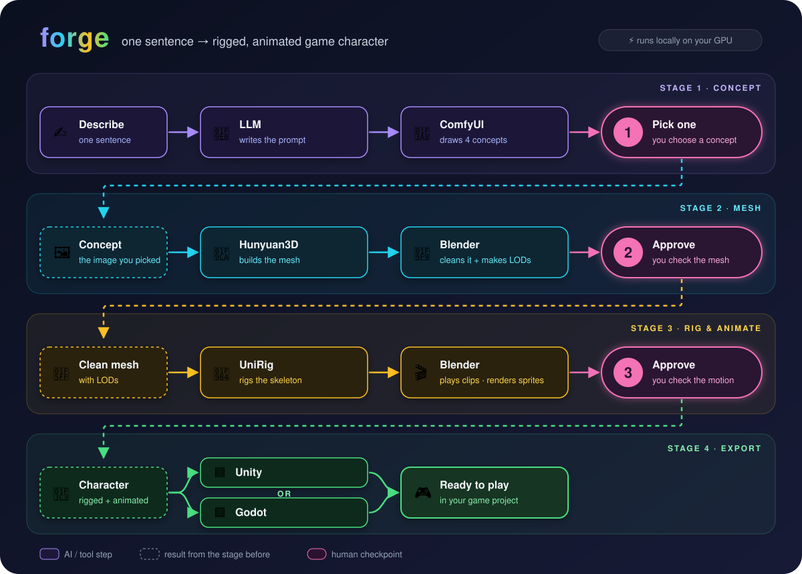

## See it work

<table>
<tr>
<td width="50%"><b>① Pick a picture</b><br/>Four candidates, each checked for cut-offs, held items and arms against the body.<br/>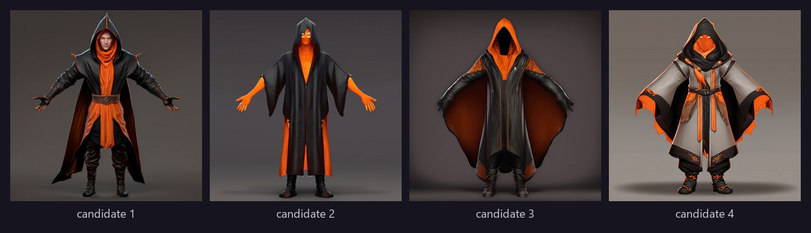</td>
<td width="50%"><b>② Approve the mesh</b><br/>Textured mesh, cleaned and decimated, judged against the picture from three sides.<br/>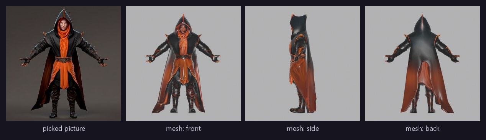</td>
</tr>
<tr>
<td colspan="2"><b>③ Approve the animation</b> — skeleton fit, stretch checks, every clip playable in the browser.<br/>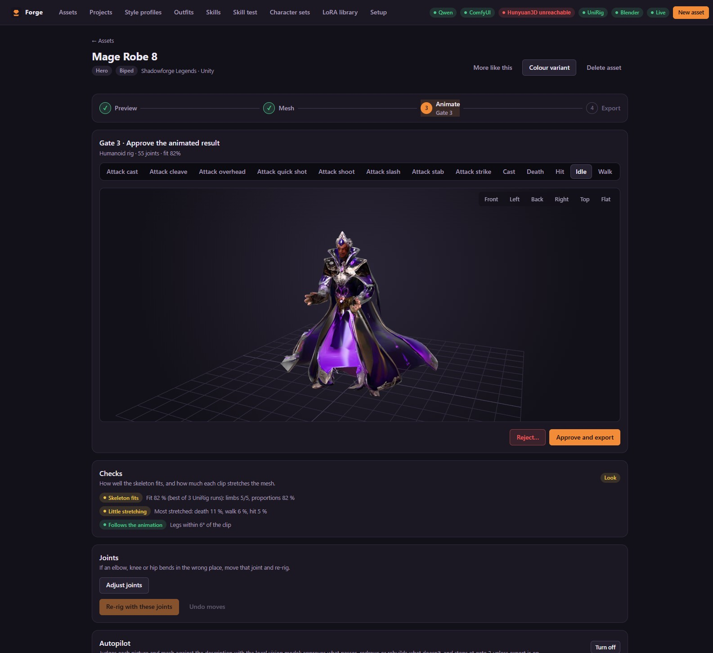</td>
</tr>
</table>

## Features

|  |  |
|---|---|
| 🧍 **Characters, gear, weapons, effects** | Heroes, monsters, bosses on six body types (biped, quadruped, flyer, serpent, spider, blob) with idle, walk, run, attack, hit and death; gear for six slots; one-/two-handed weapons, bows, staffs, shields; skill effects. |
| ✅ **Checks at every gate** | A local vision model judges pictures, meshes and motions; cut-offs, floor plates, skeleton fit, stretching and limbs that don't follow the clip are flagged and redone. |
| 🤖 **Autopilot & batches** | Up to 20 assets from one description, run model by model so the GPU swaps rarely. Autopilot picks, rebuilds and stops only when something needs you. |
| 🎨 **Style profiles** | Image model (SDXL, Qwen-Image, Flux), LoRAs, reference images, budgets (triangles, textures, LODs) and sprite camera — so a whole game's assets match. |
| 🛡️ **Gear & outfits** | Gear fitted and skinned to the body, weapons gripped on the handle, try-ons on any hero or a test dummy, colour variants in seconds. |
| ✨ **Skill effects** | Projectiles, bursts and auras as animated flipbooks (Wan 2.2), exported with a ready Godot scene and `play(from, to)`. |
| 🕺 **Skill animations** | Text → body animation with HY-Motion, four versions judged, playable by any rigged biped without re-rigging. |
| 🧩 **Character sets** | A hero, its items and skills made together in versions; pick, build, and get a manifest for your game. |
| 🦴 **Joint editor** | Move or twist any joint in the browser and re-rig when a knee bends the wrong way. |
| 🔌 **HTTP API** | Everything the app does is an API call, with live progress over WebSocket. |

<table>
<tr>
<td width="50%">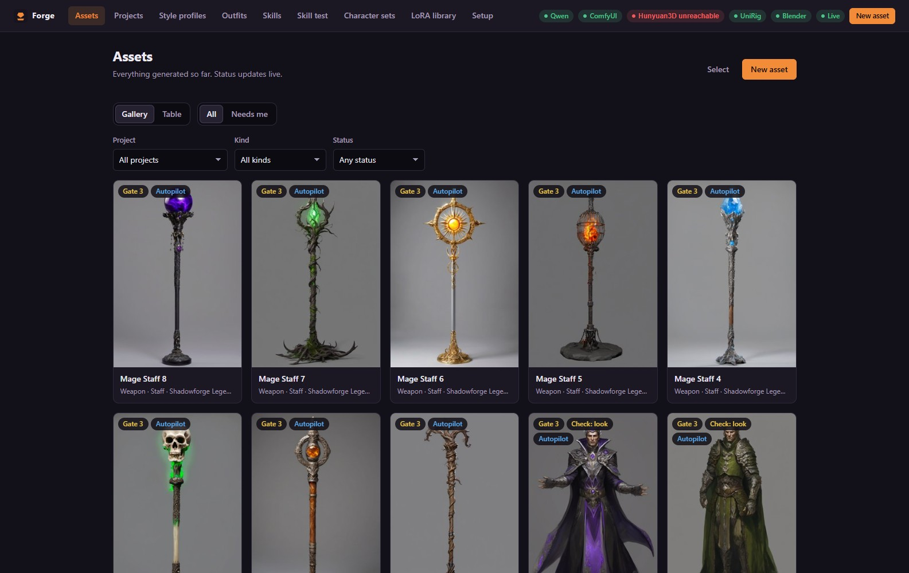<br/><sub>Gallery with live status and check badges</sub></td>
<td width="50%">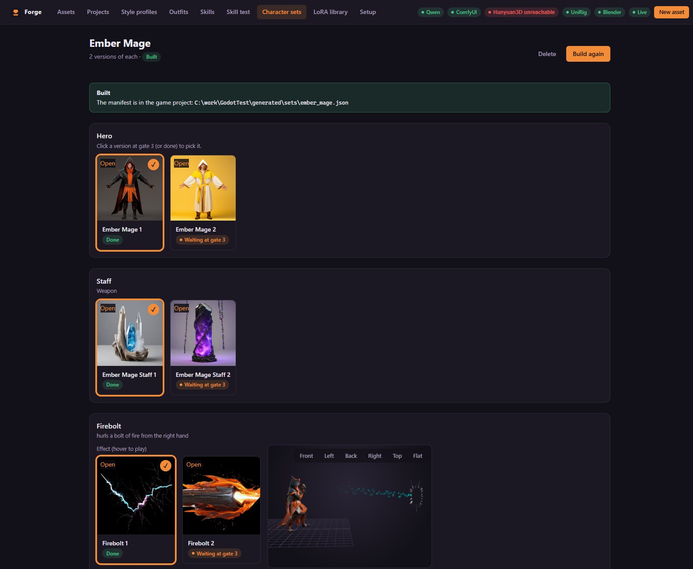<br/><sub>A character set: hero, staff and firebolt versions</sub></td>
</tr>
<tr>
<td width="50%">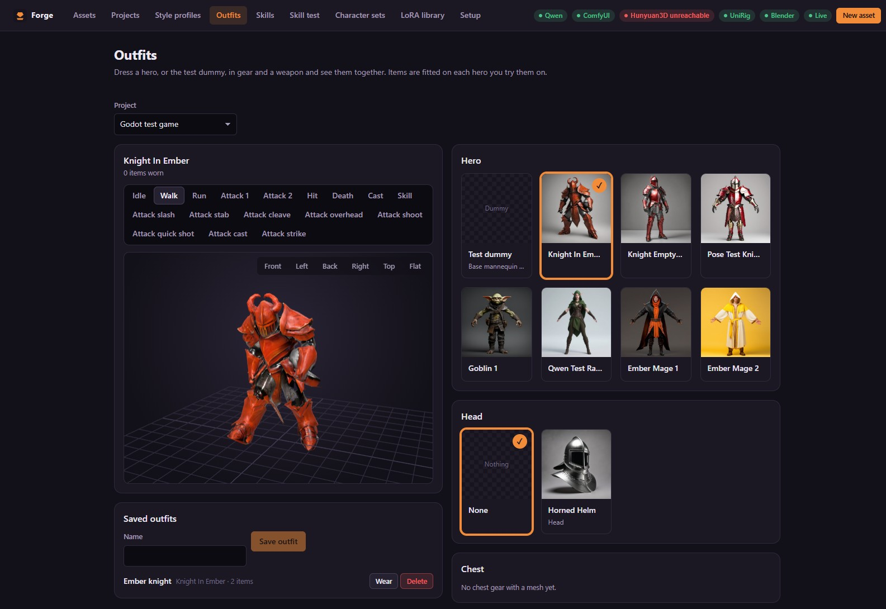<br/><sub>Outfits: try items on any hero</sub></td>
<td width="50%">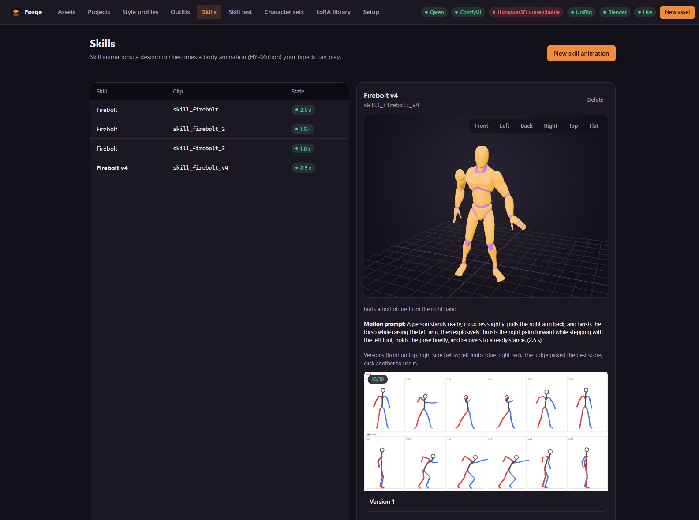<br/><sub>Skill animations: four versions, judged</sub></td>
</tr>
</table>

→ The full tour, page by page: **[docs/features.md](docs/features.md)**

## What you get

<table>
<tr>
<td width="50%"><b>Unity</b> — rigged FBX with LOD0–2 and one take per clip, URP material, animator controller, and a prefab built by an editor script Forge installs for you. Gear binds to the character's bones; weapons sit on a hand socket.</td>
<td width="50%"><b>Godot</b> — sprite sheets per direction, <code>SpriteFrames</code>, Aseprite JSON and a <code>PaperDoll.tscn</code> where body, gear and weapon layers stack frame for frame. Effects come with a <code>.tscn</code> and a script.</td>
</tr>
</table>

<p align="center">
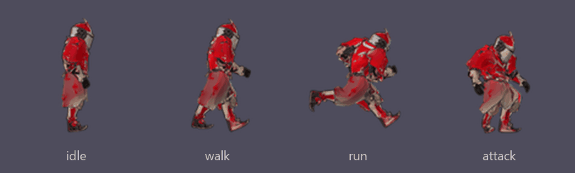<br/>
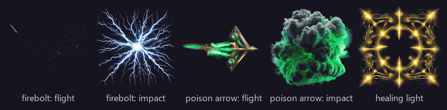<br/>
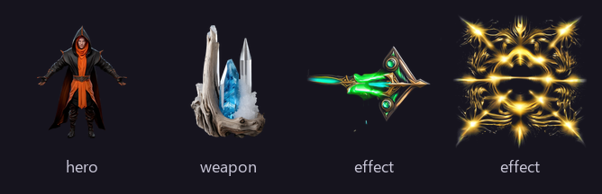
</p>

→ Every file, explained: **[docs/outputs.md](docs/outputs.md)**

## Requirements

- **NVIDIA GPU with 24 GB+ VRAM** (32 GB recommended), Windows or Linux
- [uv](https://docs.astral.sh/uv/), [Node.js](https://nodejs.org) 20+, git
- The local tools Forge drives: **LM Studio** (vision LLM), **ComfyUI** (SDXL / Qwen-Image),
  **Hunyuan3D 2.1**, **UniRig**, **Blender 4.5 LTS** — and optionally **HY-Motion** and
  **MV-Adapter**

Details, model sizes and licences: **[docs/requirements.md](docs/requirements.md)**

## Quick start

```bash
git clone https://github.com/mitsinsar/forge.git
cd forge/frontend && npm ci && npm run build
cd ../backend && uv run assetgen
```

Open **http://127.0.0.1:8000/setup**. It checks each tool live, shows the install steps for
anything missing (the same as **[INSTALL.md](INSTALL.md)**) and has buttons to start, restart or
stop them. When everything is green, click **New asset**.

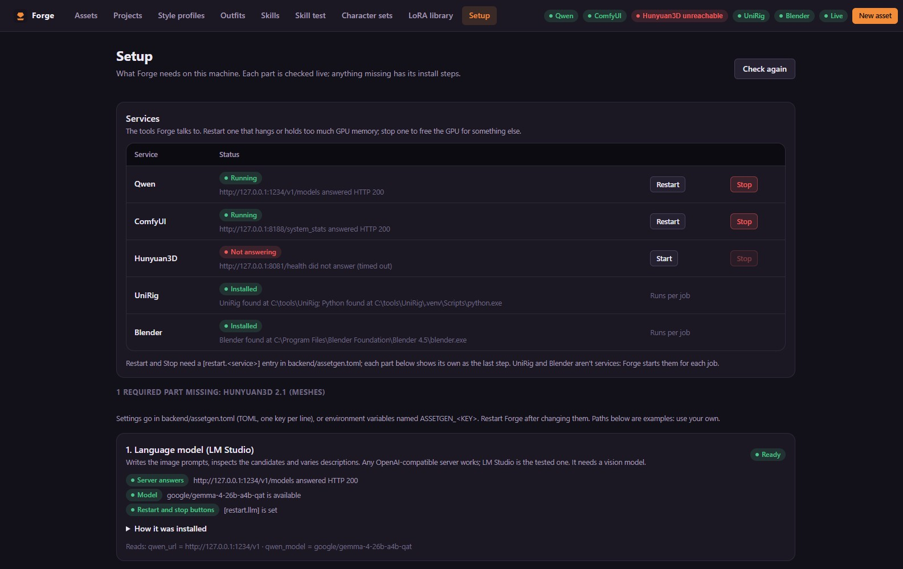

→ First asset, step by step: **[docs/getting-started.md](docs/getting-started.md)**

## Drive it from scripts

```bash
curl -X POST http://127.0.0.1:8000/api/assets -H "Content-Type: application/json" \
     -d '{"project_id": "<project id>", "kind": "hero", "description": "a knight in red plate armour", "autopilot": true}'
```

Interactive reference at `/docs`, live progress on `/api/ws`. → **[docs/api.md](docs/api.md)**

## Documentation

| | |
|---|---|
| [Requirements](docs/requirements.md) | Hardware, tools, models, licences |
| [Installation](INSTALL.md) | Every tool, step by step |
| [Getting started](docs/getting-started.md) | Your first asset |
| [Features](docs/features.md) | Everything Forge does, with screenshots |
| [Outputs](docs/outputs.md) | What lands in Unity and Godot |
| [Configuration](docs/configuration.md) | `assetgen.toml` and style profiles |
| [HTTP API](docs/api.md) | Scripting Forge |
| [Troubleshooting](docs/troubleshooting.md) | Common problems |
| [Architecture](docs/architecture.md) | How it fits together |

## Repository layout

| Folder | What is there |
|---|---|
| `backend/` | FastAPI app (`src/assetgen`), Blender scripts, ComfyUI workflows, patches for Hunyuan3D and UniRig, tests. Technical reference: [backend/README.md](backend/README.md). |
| `frontend/` | The React web app. See [frontend/README.md](frontend/README.md). |
| `docs/` | The guides above and their images. |

Tests run without a GPU: `cd backend && uv run pytest` (Blender tests run when Blender is found).

## Contributing

Issues and pull requests are welcome — see **[CONTRIBUTING.md](CONTRIBUTING.md)**. Please report
security problems privately as described in **[SECURITY.md](SECURITY.md)**.

## Licence

Forge is licensed under the [Apache License 2.0](LICENSE): use it, change it and share it,
commercially too, as long as you keep the copyright and licence notices ([NOTICE](NOTICE)) and
mark files you change.

The archetype animations are Quaternius's CC0 packs (see each `archetypes/<id>/LICENCES.md`).
The tools and models Forge drives (ComfyUI, SDXL, Qwen-Image, Flux, Hunyuan3D, UniRig,
HY-Motion, MV-Adapter, Wan, the language model) are **not part of this repository** and each has
its own licence; some, such as Hunyuan3D's and HY-Motion's community licences, limit where and how
they may be used. Read them before you ship assets made with them.
