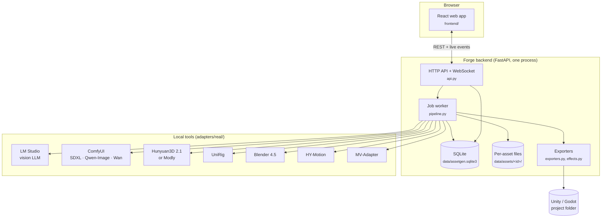

# Architecture

How Forge is put together, for contributors and for anyone wiring it into other tools.

## Pieces

| Part | Where | What it does |
|---|---|---|
| Web app | `frontend/src` | React 19 + TanStack Query + three.js viewers. Built with Vite into `frontend/dist`, served by the backend at `/`. |
| API | `backend/src/assetgen/api.py`, `schemas.py` | FastAPI routes under `/api`, request validation, the `/api/ws` event hub (`events.py`). |
| Pipeline | `pipeline.py` | Stages, gates, autopilot and the single job worker. |
| Adapters | `adapters/base.py`, `adapters/real/` | One interface per tool: LLM (`qwen.py`), images (`comfyui.py`), meshes (`hunyuan3d.py`, `modly.py`, `mvviews.py`), rig (`unirig.py`), Blender (`blender.py`), motion (`hymotion.py`). |
| Blender scripts | `backend/blender_scripts/` | Run headless: clean-up and LODs, rig and retarget, attach gear/weapons, sprite render, FBX export, mesh judge views, motion → clip. |
| Checks | `checks.py`, `pose.py`, `grips.py` | Gate checks, the A-pose guide and arms check, weapon grip finding. |
| Exporters | `exporters.py`, `effects.py`, `delivery.py`, `unity/` | Unity folders (and the editor import script they ship), Godot sprite sheets, effect scenes, zips. |
| Archetypes | `src/assetgen/archetypes/<id>/` | Template skeletons, rest poses and CC0 clips per body type. |
| Setup | `setup_guide.py`, `tools.py`, `watchdog.py` | Live tool checks, install steps (also generates `INSTALL.md`), restart/stop. |
| External runners | `backend/external/` | Scripts run inside the HY-Motion and MV-Adapter Python environments. |
| Patches | `backend/patches/` | Forge's changes to Hunyuan3D 2.1 and UniRig (Windows). |

## How a job runs

- **One worker, one GPU job at a time.** Stages of assets and side jobs (fits, example sheets,
  motions) share one queue, oldest first, so the GPU is never shared.
- **Model-aware scheduling.** Each queued step knows which model it needs (`llm`, `image`,
  `video`, `mesh`, `rig`). The worker prefers steps on the model it used last, and a stage that
  reaches a step on another model steps back into the queue. A batch therefore runs every prompt,
  then every drawing, every judging, every mesh.
- **One model on the GPU.** Switching models unloads the previous one (LM Studio's API,
  ComfyUI's `/free`, the patched Hunyuan3D server frees its cache after each job).
- **Resumable.** Each stage writes into `data/assets/<id>/<stage>/` and ends with a
  `manifest.json`. After a restart, running assets go back in the queue; finished stages aren't
  redone and adapters skip files that already exist.
- **Gates.** Approving keeps everything upstream and queues the next stage; rejecting reruns only
  that stage with the note.
- **Self-healing tools.** With a `[restart.<tool>]` entry, a stage that fails because ComfyUI or
  Hunyuan3D didn't answer or ran out of memory restarts that tool once and runs again.

## Tests

`cd backend && uv run pytest` runs the whole pipeline on **GPU-free doubles** (`tests/fakes/`:
placeholder images, ellipsoid meshes and animations), the real adapters against fake LLM,
ComfyUI and Hunyuan3D servers, and the Blender scripts when Blender is installed (skipped
otherwise). `tests/unity/` holds a batch-mode check of the Unity import script (run by hand).

The detailed, technical reference for every stage is [backend/README.md](../backend/README.md).
