# Features

A tour of what Forge does, page by page. For the files Forge writes into your game, see
[Outputs](outputs.md); for the settings behind each feature, see [Configuration](configuration.md).

- [The pipeline and its three gates](#the-pipeline-and-its-three-gates)
- [Asset kinds and archetypes](#asset-kinds-and-archetypes)
- [Quality checks and the local judge](#quality-checks-and-the-local-judge)
- [Autopilot and batches](#autopilot-and-batches)
- [Gear, weapons and outfits](#gear-weapons-and-outfits)
- [Joint editor and re-rigging](#joint-editor-and-re-rigging)
- [Skill effects](#skill-effects)
- [Skill animations](#skill-animations)
- [Character sets](#character-sets)
- [Style profiles and LoRAs](#style-profiles-and-loras)
- [Colour variants and "more like this"](#colour-variants-and-more-like-this)
- [Setup, tools and storage](#setup-tools-and-storage)

---

## The pipeline and its three gates

Every asset goes through four stages. After each of the first three, Forge stops at a **gate**
and waits for you (or the autopilot) to approve or reject.

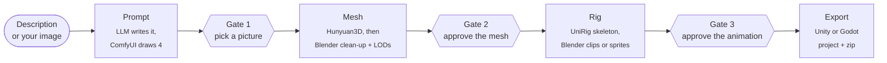

**Rejecting** a gate reruns only that stage, with your note folded into the next attempt;
everything upstream is kept. A stage that fails (a tool was down, out of memory) can be retried
and resumes from the files it already wrote, so nothing is redone after a restart either.

### Gate 1 — pick a picture

The language model expands your description into an image prompt, and ComfyUI draws four
candidates in the profile's style. Characters are held in an A-pose by an OpenPose ControlNet so
arms don't fuse to the body in the mesh. Each candidate is checked before you see it; ones that
fail are redrawn with other seeds.

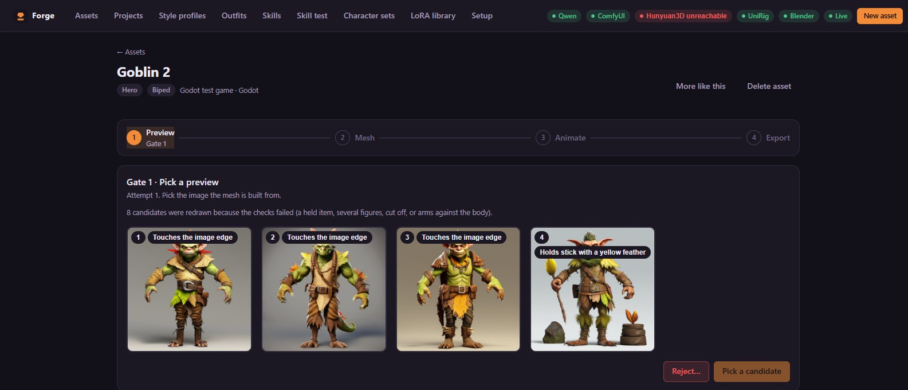

You can also start from **your own image** instead of a description: it becomes the only
candidate.

### Gate 2 — approve the mesh

Hunyuan3D 2.1 turns the picked picture into a textured mesh. Blender then cleans it (loose
pieces, floating debris, interior faces), scales it to the kind's standard height, evens out the
light baked into the texture, decimates it to the profile's triangle budget and builds the LODs.
The local judge renders it from the front, side and back and compares it with the picture.

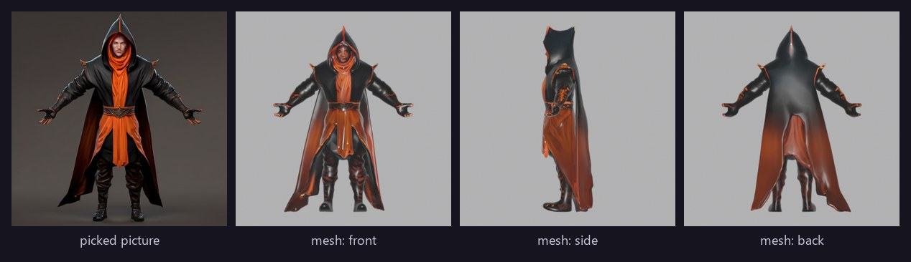

### Gate 3 — approve the animated result

UniRig predicts a skeleton and skin weights; Blender fits the archetype's template skeleton and
retargets its clips onto the model. You can play every clip in the viewer, look along any axis,
and see how well the skeleton fits and how much each clip stretches the mesh.

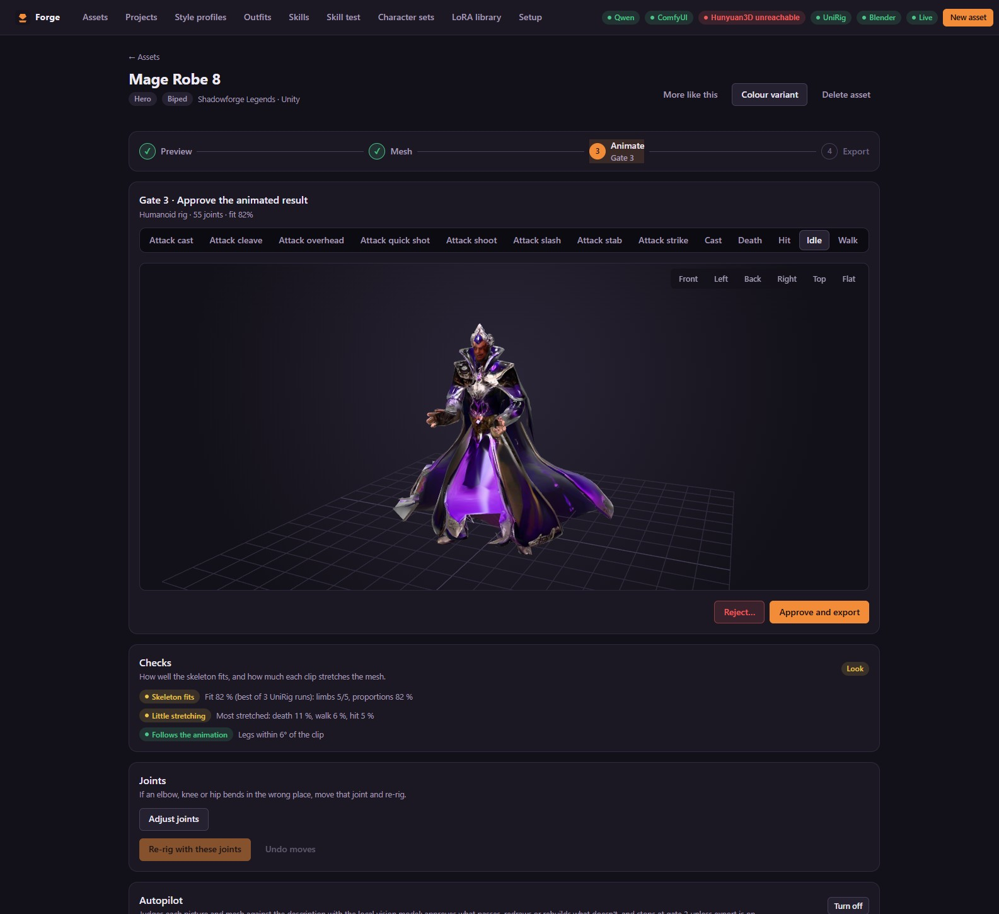

For Godot projects, gate 3 also plays the rendered sprite frames, so you approve what the game
will actually show.

### Export

The approved asset is written straight into your registered Unity or Godot project, and is
also downloadable as a zip.

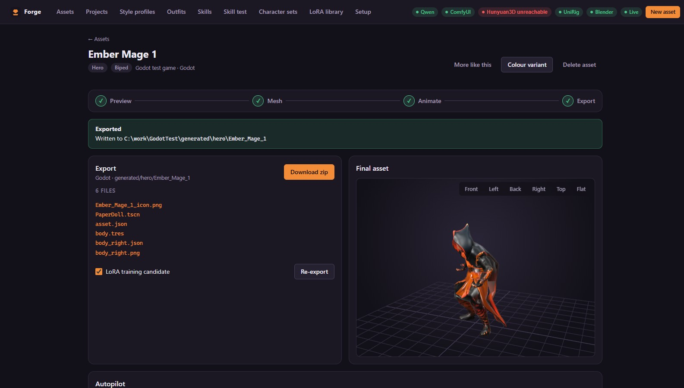

---

## Asset kinds and archetypes

| Kind | What it is | Default height |
|---|---|---|
| **Hero** | Player characters and NPCs | 1.8 m |
| **Monster** | Enemies | 1.5 m |
| **Boss** | Big enemies | 2.7 m |
| **Gear** | Wearables for one slot: head, chest, legs, hands, feet, cape | fitted to the wearer |
| **Weapon** | One-handed, two-handed, bow, staff, shield | about 1 m long |
| **Effect** | Skill effects: projectiles, bursts, auras | — |

Characters are rigged on one of six **archetypes**, picked from the description or by you:

| Archetype | Rig | Clips |
|---|---|---|
| **Biped** | Humanoid | idle, walk, run, attack ×2, hit, death, cast, skill, plus two attacks per weapon class |
| **Quadruped**, **Flyer**, **Serpent**, **Spider**, **Blob** | Generic | idle, walk, run, attack ×2, hit, death |

The clips are Quaternius's CC0 animation packs, retargeted onto each model. A style profile can
add generated skill animations to every biped.

---

## Quality checks and the local judge

Every gate has checks, each **pass**, **warn** or **fail**, shown at the gate and as badges in the
gallery. The vision model running in LM Studio acts as a local judge — nothing leaves your
machine.

| Gate | Checks |
|---|---|
| **1** | One subject; nothing cut off by the image edge; arms clear of the body; empty hands (characters); a single piece for paired gear; how well the picture **matches the description** (0–10, with what is wrong) |
| **2** | Loose pieces and holes in the cleaned mesh; whether the mesh **looks like the picture** from the front, side and back (0–10) |
| **3** | How well the skeleton fits (UniRig reruns with other seeds while the fit is poor and keeps the best); how much each clip stretches or squeezes the mesh; whether the limbs follow the animation |

Failed candidates are redrawn automatically, and when the judge found problems, the prompt is
rewritten with them in mind.

---

## Autopilot and batches

Turn on **autopilot** for an asset and Forge decides each gate from the checks and logs why:

- **Gate 1** — takes the best candidate (fewest problems, then the judge's score); if none is
  usable, draws again with the judge's notes.
- **Gate 2** — approves, or rebuilds the mesh with a new seed, then tries the next-best picture.
- **Gate 3** — stops for you, ready to approve, unless *export by itself* is on.

A failed check always stops the autopilot so you can look.

**Batches** make up to 20 assets from one description — the same one with other seeds, or varied
by the language model. Batches run **model by model**: every prompt, then every drawing, every
judging, every mesh — so the GPU switches models a few times per batch, not per asset.

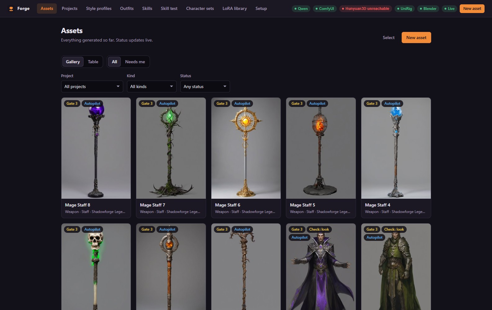

---

## Gear, weapons and outfits

- **Gear** is fitted onto the biped body by its slot: scaled and placed by the slot's bounds,
  pushed out of the body so nothing clips, and given the body's skin weights. Gloves, boots and
  leg armour are drawn as one piece and mirrored for the other side. The body faces a piece covers
  are recorded so the game can hide them.
- **Weapons** stay rigid and are parented to a hand socket. Forge finds the grip on the handle
  automatically; you can type a grip at gate 3 and re-rig. Two-handed weapons get a second grip.
- **Wearer** — fit an item on the base mannequin (the **test dummy**) or on any rigged hero of
  the project, so it matches that hero's height and build.
- Every mesh also gets a 512 px **inventory icon** with a transparent background.

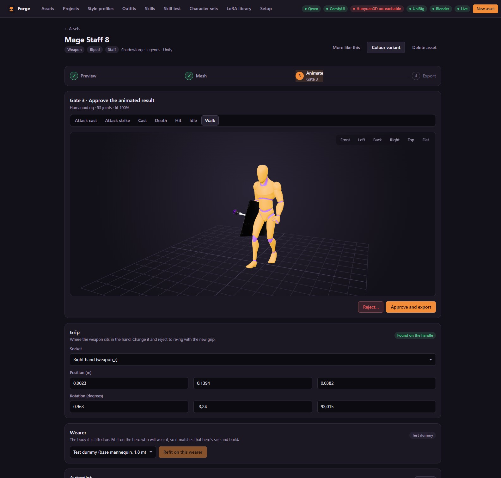

The **Outfits** page dresses any hero (or the test dummy) in gear and a weapon, plays every clip
with them on, lets you nudge an item into place by hand, and saves the combination.

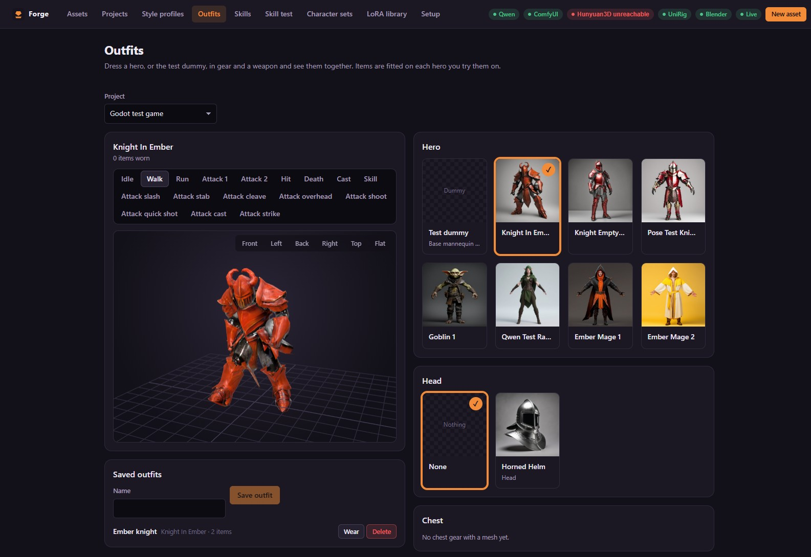

---

## Joint editor and re-rigging

If an elbow, knee or hip bends the wrong way, open **Adjust joints** at gate 3. The editor draws
the skeleton over the model in its rest pose; click a joint, move or twist it (optionally mirrored
to the other side), and use **Face forward** to turn knees and elbows the right way. **Re-rig with
these joints** reruns only the rig stage with your joints in place of UniRig's.

---

## Skill effects

An effect (a firebolt, a poison arrow, a healing glow) goes through the same three gates with its
own stages:

1. **Prompt** — the language model plans the effect: a projectile with an impact, a burst, or an
   aura, plus an optional cast, a palette, trail particles and a travel speed. Each part is drawn
   alone on black.
2. **Flipbooks** — each part is animated by Wan 2.2 in ComfyUI and turned into a 16-frame
   flipbook (brightness becomes alpha; loops are cross-faded). Any part can be animated or drawn
   again on its own.
3. **Sequence** — the parts together, played as the game will: cast, flight with the trail,
   impact.

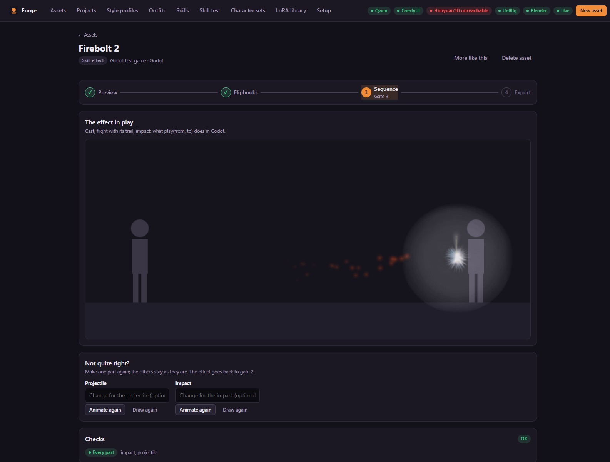

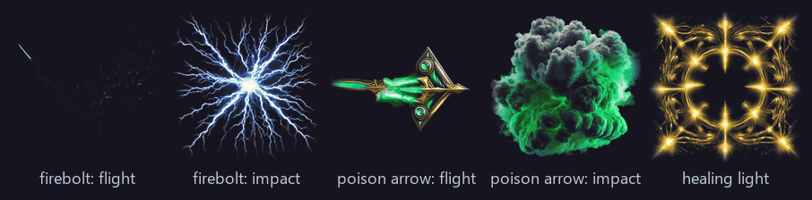

---

## Skill animations

The **Skills** page turns a description ("hurls a fireball with the right hand") into a body
animation any biped can play, using **HY-Motion 1.0**. The language model writes the motion
prompt with game timing (ready, wind-up, strong action, hold, recovery); HY-Motion makes four
versions; each is drawn as a stick-figure sheet from the front and the side, and the vision model
scores them. The best becomes the clip, and you can pick another.

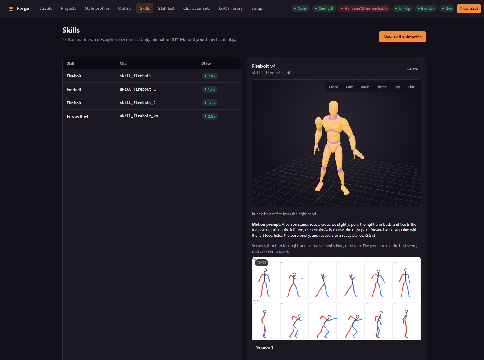

A rigged hero can play a new skill animation in seconds without being rigged again. The **Skill
test** page plays a hero, a skill animation and an effect together, with the effect leaving the
hand at the release time you set.

---

## Character sets

A **character set** is a hero, its items and its skills, made together. Describe them once and
Forge makes several versions of each on autopilot up to gate 3. Pick one version per slot, try
them together, then **Build**: the skill animations go into the hero's rig, the items are re-fitted
on that hero, everything is exported, and a manifest (`generated/sets/<name>.json`) lists the
hero, items, and each skill's clip, release time and effect for the game to load.

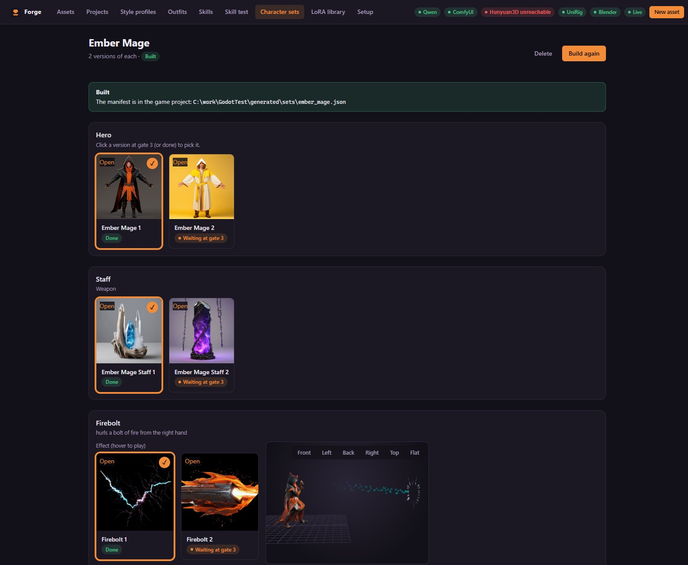

---

## Style profiles and LoRAs

A **style profile** keeps a whole game's assets consistent. It holds:

- **Models** per step — the language model, the image model (SDXL, Flux, Qwen-Image) and the 3D
  model — and whether only one model holds the GPU at a time.
- **Look** — prompt suffix, negative prompt, LoRAs with weights, and up to three reference images.
- **Mesh quality** — Hunyuan3D steps, surface resolution, guidance, floating-piece removal,
  multi-view meshes and light evening.
- **Sprite render** (Godot) — camera preset (side, three-quarter, top-down 4/8 directions),
  HD or pixel look, frame rate, supersampling, palette size and frame size per kind.
- **Budgets** — triangles and texture size per kind, and the LOD levels.
- **Clips** — the clip set and extra clips (such as generated skills) for bipeds.

**Make examples** renders a knight, a wolf and a sword in the profile's style so you can see it
before you commit. The **LoRA library** stores each LoRA with its base model, trigger words,
licence and a commercial-use flag, and can render examples with and without it.

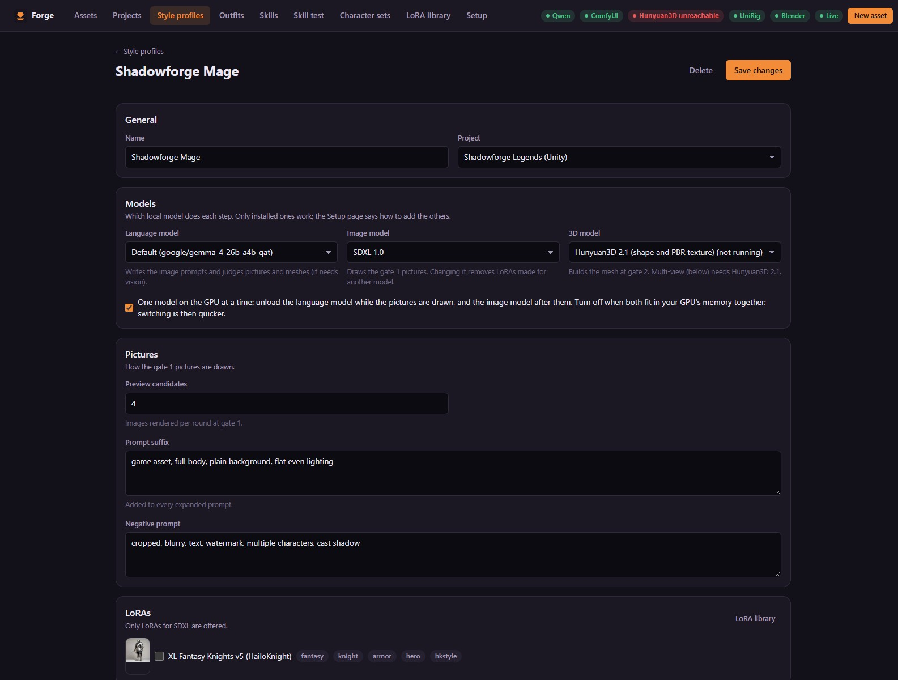

---

## Colour variants and "more like this"

- **Colour variant** copies a rigged asset with its texture recoloured (hue, saturation,
  brightness, tint). The mesh, skeleton and clips are kept, so it takes seconds and fits the same
  gear.
- **More like this** starts a new asset from an existing one's description and settings.

---

## Setup, tools and storage

The **Setup** page checks every tool live, shows the install steps (with copy buttons) for
anything missing, and has **Restart / Start / Stop** buttons for each service. The header shows
each tool's state; a red badge restarts its tool on a click. When ComfyUI or Hunyuan3D stops
answering or runs out of memory mid-stage, Forge restarts it once and carries on.

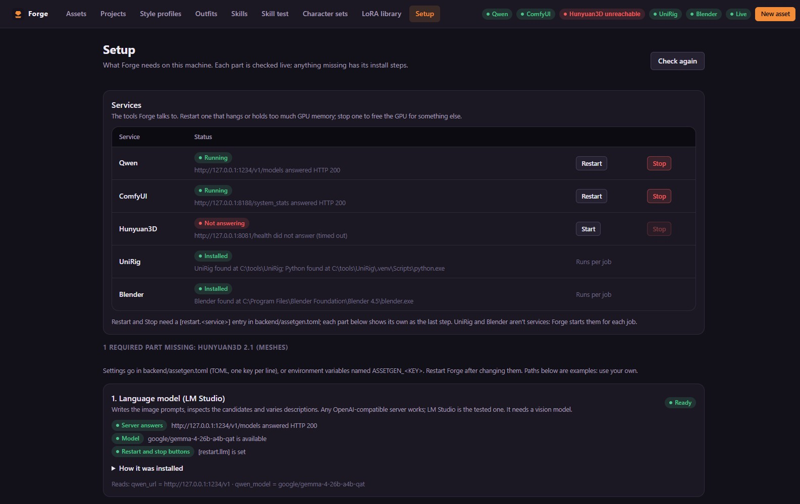

The **Storage** card on the Projects page shows and deletes what can be rebuilt or is no longer
used: UniRig working files, thumbnails, files of deleted assets.
