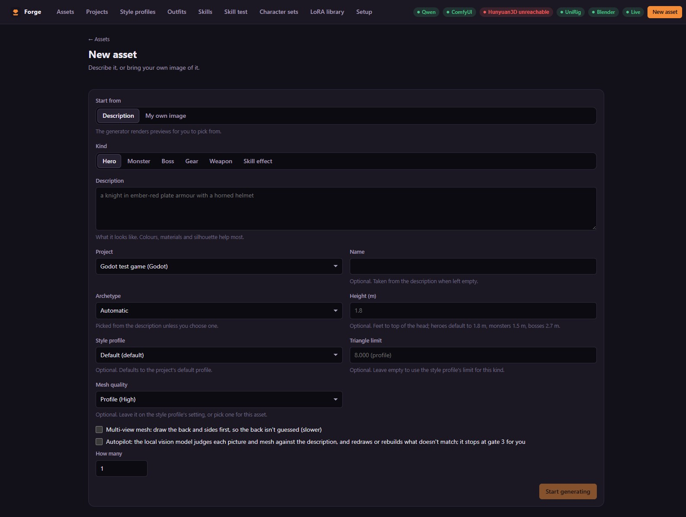

# Getting started

From a fresh checkout to your first exported asset. Before this, check
[Requirements](requirements.md).

## 1. Install and start the app

```bash
git clone https://github.com/mitsinsar/forge.git
cd forge/frontend
npm ci
npm run build
cd ../backend
uv run assetgen
```

The first run installs the Python packages. Open **http://127.0.0.1:8000**.

## 2. Install the tools

Open **http://127.0.0.1:8000/setup**. Every tool starts red. Follow the steps shown for each (the
same steps are in [INSTALL.md](../INSTALL.md)), in order:

1. LM Studio and a vision model
2. ComfyUI and SDXL (plus the optional pose ControlNet and Qwen-Image)
3. Hunyuan3D 2.1, with Forge's patch
4. UniRig
5. Blender 4.5 LTS
6. *Optional:* HY-Motion (skill animations), MV-Adapter (multi-view meshes)

Tell Forge where each one is in `backend/assetgen.toml` (see [Configuration](configuration.md)),
restart Forge and press **Check again**. When the header badges are green, you're ready.

> **Tip:** add a `[restart.<tool>]` entry for ComfyUI, Hunyuan3D and LM Studio. Forge can then
> start, stop and restart them from the Setup page, and restart a tool by itself when it hangs or
> runs out of memory mid-stage.

## 3. Register a game project

On **Projects**, add your game: a name, the engine (**Unity** or **Godot**) and the path to the
project folder. A *Default* style profile is made for it. Exports go straight into this folder.

## 4. Make your first asset

1. Click **New asset**.
2. Pick a kind — start with a **Hero** — and describe it. Colours, materials and silhouette help
   most: *"a knight in ember-red plate armour with a horned helmet"*.
3. Leave the archetype on **Automatic** and press **Create**.



The asset appears in the gallery with live progress.

## 5. Go through the gates

| Gate | What you do | If it's not right |
|---|---|---|
| **1 · Pick a preview** | Click the best of the four pictures and **Pick**. Check badges flag cut-off figures, held items and arms against the body. | **Reject** with a note ("no cape", "darker armour") to draw four new ones. |
| **2 · Approve the mesh** | Turn the model around in the viewer; look at the triangle count, LODs and the judge's score. | **Reject** to rebuild with a new seed or other mesh settings; or go back and pick another picture. |
| **3 · Approve the animation** | Play every clip. Check the skeleton fit and stretching. For Godot, watch the sprite frames. | **Adjust joints** and re-rig, or **Reject** to re-rig with other seeds. |

**Approve and export** writes the asset into your project. That's it.

## 6. Use it in your engine

- **Unity** — switch to the editor. The import script Forge put in `Assets/Generated/Editor/`
  builds a prefab with materials, LOD group and animator controller. Drag
  `Assets/Generated/hero/<Name>/<Name>.prefab` into a scene.
- **Godot** — open `res://generated/hero/<Name>/PaperDoll.tscn` and press play on its
  `AnimatedSprite2D`s, or instance it in your scene.

See [Outputs](outputs.md) for every file.

## Next steps

- **Let it run by itself:** tick *Autopilot* on New asset; Forge decides each gate from its
  checks and stops at gate 3 for you (or exports too, with *export by itself*).
- **Make many at once:** set a count of up to 20 on New asset — the same description with other
  seeds, or varied by the language model.
- **Set your game's look:** edit the style profile — image model, LoRAs, reference images,
  budgets, sprite camera. Press **Make examples** to preview it.
- **Dress your heroes:** make gear and weapons, then try them on in **Outfits**.
- **Add skills:** make an effect (kind *Skill effect*) and a skill animation on **Skills**, then
  try them together on **Skill test**, or make a whole **Character set**.
