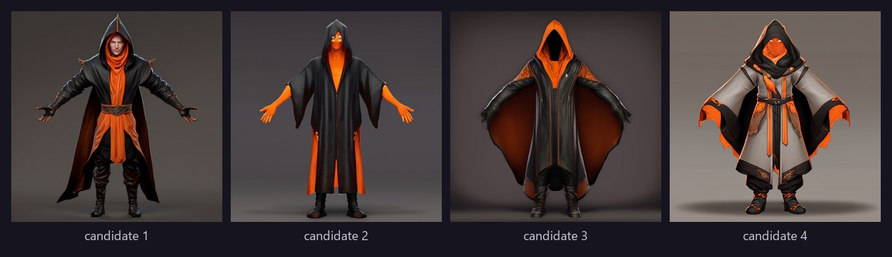
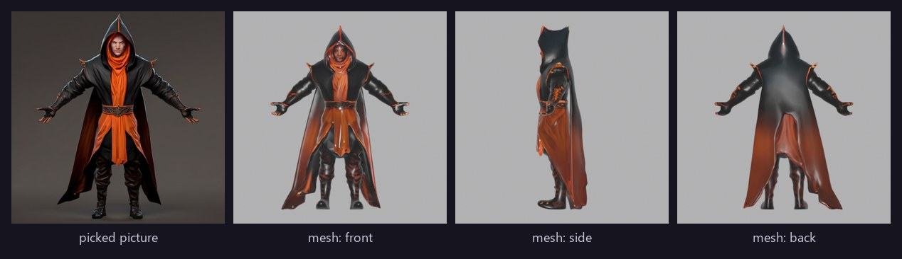
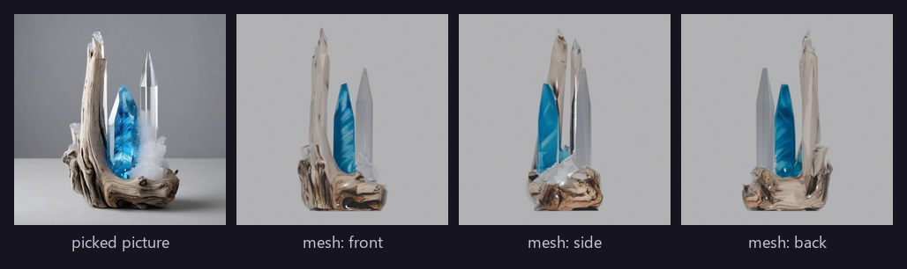
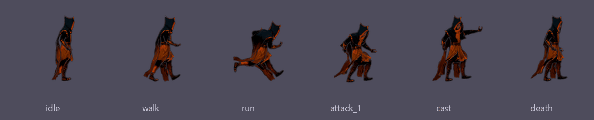
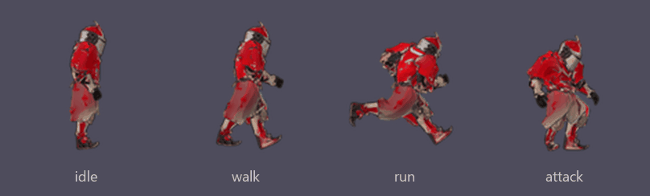
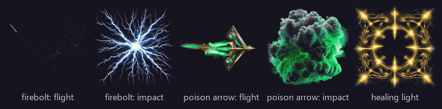
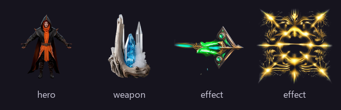

# Outputs

What Forge writes, and where. Every export goes straight into the game project you registered,
and the same folder can be downloaded as a zip from the asset page.

## At a glance

| | Unity | Godot |
|---|---|---|
| Characters | Rigged **FBX** with LOD0–2 and one take per clip, albedo texture, prefab, material, animator controller | **Sprite sheets** per direction, Aseprite JSON, `SpriteFrames`, `PaperDoll.tscn` |
| Gear | Skinned FBX on the shared skeleton + `AssetForgeGear` component | A sprite layer that stacks on the body frame for frame |
| Weapons | Rigid FBX in grip space, socket and grip in `asset.json` | A `weapon` sprite layer |
| Effects | Flipbook sheets + JSON for a Particle System's Texture Sheet Animation | Sheets, `SpriteFrames`, a ready `.tscn` with particles, and a `.gd` with `play(from, to)` |
| Every asset | `asset.json` sidecar and a 512 px inventory icon | same |

## Examples

### Gate 1 candidates

Four pictures per round in the style profile's look; characters in an A-pose.



### Picture → mesh

The cleaned, textured mesh, rendered from three sides by the mesh judge.





### Animated sprites (Godot)

Rendered by Blender with a toon look and outline, one framing for every clip so the character
keeps its size and ground line. HD (smooth) or pixel (nearest-neighbour, shared palette) looks.





### Effects

16-frame flipbooks per part, brightness as alpha, glowing parts drawn additive.



### Icons



## Unity

Folder: `<project>/Assets/Generated/<kind>/<Name>/`

```
Assets/Generated/
├── Editor/
│   ├── AssetForgeImporter.cs        # written on first export; builds the prefabs
│   └── AssetForge.Editor.asmdef     # editor-only
├── Runtime/
│   ├── AssetForgeGear.cs            # binds gear to a character's bones
│   └── AssetForge.Runtime.asmdef
└── hero/
    └── Knight/
        ├── Knight.fbx               # mesh, skeleton, one take per clip, Knight_LOD1/LOD2
        ├── Textures/Knight_Albedo.png
        ├── asset.json               # rig type, LODs, clips, slot / socket / grip
        ├── Knight_icon.png
        ├── Knight.prefab            # made by the import script
        ├── Knight.controller        #   one state per clip, idle first
        └── Materials/Knight.mat     #   URP Lit
```

What the import script does when Unity imports an export:

1. Imports the FBX at scale 1 — **Humanoid** avatar for bipeds, **Generic** otherwise; each clip
   cut to its length with its loop flag.
2. Makes a URP Lit material with the albedo.
3. Makes an animator controller with one state per clip (characters).
4. Makes a prefab with a `LODGroup` (LOD0/1/2) and the Animator.
   - **Weapons:** the prefab root *is* the grip. Parent it to the `weapon_r` (or `weapon_l`) bone
     with zero local position and rotation.
   - **Gear:** parent it under a character; `AssetForgeGear` binds its skinned meshes to the
     wearer's bones by name.

Re-exports update everything **in place**: GUIDs, the prefab root and scene references survive.
**Tools → AssetForge → Rebuild All Prefabs** rebuilds every folder by hand. Written for Unity 6
LTS with URP.

## Godot

Folder: `<project>/generated/<kind>/<Name>/` (`res://generated/<kind>/<Name>/`)

```
generated/
├── hero/Knight/
│   ├── body_right.png       # atlas: every clip, one direction
│   ├── body_right.json      # Aseprite JSON with a frame tag per clip
│   ├── body.tres            # SpriteFrames: one animation per <clip>_<direction>
│   ├── PaperDoll.tscn       # ready scene
│   ├── Knight_icon.png
│   └── asset.json
├── gear/Horned_Helm/head_right.png …      # layer named after the slot
├── weapon/Warden_Longsword/weapon_right.png …
├── effect/Firebolt/
│   ├── Firebolt_projectile.png  Firebolt_impact.png  Firebolt_cast.png
│   ├── Firebolt_frames.tres     # an animation per part
│   ├── Firebolt.tscn            # AnimatedSprite2D per part + GPUParticles2D trail
│   └── Firebolt.gd              # play(from, to) → cast, fly, signal hit, impact
└── sets/ember_mage.json         # character-set manifest
```

**Paper doll:** biped heroes, gear and weapons share one sprite framing, and heroes and gear also
play every weapon class's attacks, so a body layer, a helmet layer and a sword layer stack frame
for frame as three `AnimatedSprite2D` nodes. Mirrored directions (such as *left* on the side
camera) use `flip_h`.

**Camera presets:** `side` (right, mirrored for left), `three_quarter` (down-right, up-right),
`topdown_4` and `topdown_8`.

## `asset.json`

Every export carries a sidecar that tools and the import scripts read. Abbreviated, for a weapon
exported to Godot:

```jsonc
{
  "generator": "assetgen",
  "id": "266a89153238",
  "name": "Warden Longsword",
  "kind": "weapon",
  "archetype": "biped",
  "layer": "weapon",
  "camera_preset": "side",
  "directions": ["right"],
  "mirrored": { "left": "right" },
  "frame_size": 256,
  "fps": 12,
  "look": "hd",
  "clips": [
    { "name": "idle", "loop": true, "frames": 30 },
    { "name": "walk", "loop": true, "frames": 16 },
    { "name": "attack_slash", "loop": false, "frames": 18 }
    // …every clip
  ],
  "sprite_frames": "res://generated/weapon/Warden_Longsword/weapon.tres",
  "scene": "res://generated/weapon/Warden_Longsword/PaperDoll.tscn",
  "weapon": { "class": "one_handed", "grip": { "socket": "weapon_r" /* , position, rotation… */ } }
}
```

Unity exports carry the rig type, LODs, clips, and the slot, bones and hidden body parts (gear) or
socket and grip (weapons).

## Inside Forge's data folder

Everything the pipeline makes is kept per asset in `backend/data/assets/<id>/<stage>/` —
`prompt/` (candidates, pose guide), `mesh/` (raw and cleaned GLBs, texture, icon, judge renders),
`rig/` (UniRig output, the rigged Blender scene, the animated GLB), `sprites/` and `export/` —
each with a `manifest.json`. This is what lets a stage resume after a restart.
